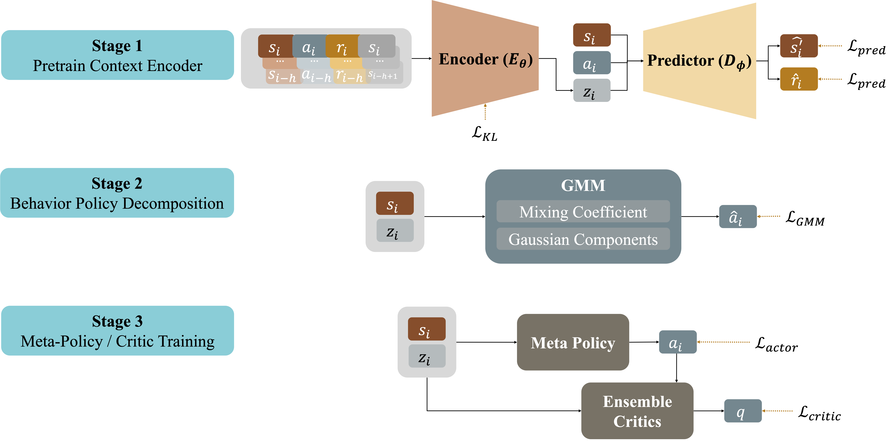
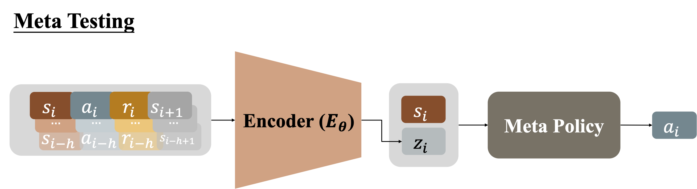

# Multi-modal Offline Decomposition for Expertise (MODE)

The official code repository for the ECML 2026 paper, [**Multi-modal Offline Decomposition for Expertise (MODE)**](https://link.springer.com/chapter/10.1007/978-3-032-37670-1_20).

## Overview
MODE is a context-conditioned framework for offline meta-reinforcement learning. The method infers a compact latent task representation from short transition histories and uses the inferred context for downstream offline policy learning.

The implementation is organized around a data preparation procedure followed by
three training stages:

1. **Context encoder pretraining.** An RNN-based Gaussian Mixture VAE encodes short sequences of states, actions, and rewards. State-transition and reward predictors provide auxiliary reconstruction objectives.
2. **Behavior policy decomposition.** A Gaussian-mixture policy models multimodal behavior conditioned on the current state and inferred context.
3. **Meta-policy and critic training.** A context-conditioned meta-policy selects mixture components, while an ensemble of critics provides the value signal for policy optimization.

The complete
meta-training and meta-testing workflow is illustrated as below:
 


<!-- 
## Repository Structure

```text
.
├── configs/                         # Environment-specific argument definitions
├── context/                         # Context dataset, encoder, and decoder models
├── data_collection/                 # Replay buffer, SAC, and data-collection models
├── downstream_gmvae_hlom_givencontext/
│   ├── agent.py                     # Context-conditioned downstream agent
│   ├── evaluation.py                # Evaluation utilities
│   └── loss.py                      # Auxiliary loss implementations
├── src/
│   ├── envs.py                      # Environment wrappers and task interfaces
│   ├── nn.py                        # Neural-network building blocks
│   ├── utils.py                     # Shared utilities
│   └── tp_envs/                     # Custom MuJoCo and toy environments
├── train_context.py                 # Stage 1: train the context model
├── train_context.sh                 # Stage 1 training sweep
├── downstream_train.py              # Stage 2/3: train the downstream agent
├── downstream_train.sh              # Multi-seed downstream training sweep
├── train_data_collection.py         # Train SAC experts for each task
├── get_datasets.py                  # Roll out experts and build offline datasets
├── asset/                           # Meta-training and meta-testing pipeline figures
├── utils.py                         # Root-level utilities
├── requirements.txt                 # Python dependencies
└── LICENSE                          # Repository license
``` -->

## Installation

The reference environment uses Python 3.7 and the pinned versions in `requirements.txt`. The project depends on the legacy Gym API and MuJoCo, so using a dedicated Conda environment is recommended.

```bash
conda create -n mode python=3.7.12
conda activate mode
pip install -r requirements.txt
```

The MuJoCo installation may also require platform-specific system libraries and simulator configuration.

## Data Preparation

Before the three MODE training stages, we need a two-step data
collection procedure to generate the multi-task offline dataset. First, we trains a task-specific
SAC agent. Second, it loads the checkpoints and
rolls them out to construct fixed-size offline replay datasets.

### 1. Train Task Experts

```bash
python train_data_collection.py \
    --env_type ant_dir \
    --save_freq 4000 \
    --task_id_start 0 \
    --task_id_end 5
```

These checkpoints are stored under:

```text
datasets/{env_name}/checkpoints/task_{task_id}/agent_{step}.pt
```

Training and evaluation logs are written to
`runs/{env_name}/data_collection/task_{task_id}/`.

### 2. Generate Offline Datasets

Once those checkpoints are available, generate one replay file per task:

```bash
python get_datassets.py \
    --env_type ant_dir \
    --data_type medium \
    --task_id_start 0 \
    --task_id_end 5 \
    --capacity 20000
```

The resulting files are written to:

```text
datasets/{env_name}/{data_type}/
├── dataset_task_0.pkl
├── dataset_task_1.pkl
└── task_info*.json
```

Each replay file contains observations, actions, rewards, next observations,
terminal flags, and timeout masks.

### Dataset Download
We also provide our datasets via this [dataset](https://drive.google.com/drive/folders/1E8Wpy15G5p0_r_t3XHSqk19ljeQ3IgHg?usp=sharing).
The training scripts expect offline datasets under `datasets/`, relative to the repository root. For an environment named `ENV_NAME` and a data setting named `QUALITY`, the expected layout is:

```text
datasets/
└── ENV_NAME/
    └── QUALITY/
        ├── task_info.json
        ├── dataset_task_0.pkl
        ├── dataset_task_1.pkl
        └── ...
```

Each task file should contain the transition arrays used by `context/dataset.py`, including observations, actions, rewards, terminal indicators, and masks. The standard format uses keys such as:

```text
observations, actions, rewards, next_observations,
terminals, masks
```

Environment-specific task definitions are loaded from files such as:

```text
datasets/AntDir-v0/task_goals.pkl
datasets/HalfCheetahVel-v0/task_goals.pkl
datasets/HopperRandParams-v0/task_goals.pkl
datasets/WalkerRandParams-v0/task_goals.pkl
```

## Training

### Stage 1: Context Encoder Pretraining

The encoder receives a short transition history
$(s_{i-h}, a_{i-h}, r_{i-h}, \ldots, s_i, a_i, r_i)$ and produces a latent task
context $z_i$. The state and reward predictors use $(s_i, a_i, z_i)$ to predict
the next state and reward. The objective combines prediction losses with the
GMVAE KL regularization shown in the meta-training diagram.

```bash
python train_context.py \
    --env_type ant_dir \
    --data_quality medium \
    --context_train_epochs 201
```

Context checkpoints are written below:

```text
saves/{env_name}/context_gmvae/{data_quality}/{seed}/horizon{context_horizon}/
```

Run the provided Stage 1 sweep with:

```bash
bash train_context.sh
```

The sweep covers `cheetah_vel`, `hopper`, `walker`, and `ant_dir` with the
`medium` and `medium-expert` data settings.

### Stage 2: Behavior Policy Decomposition

The downstream agent uses the current state and frozen context representation
to parameterize a Gaussian-mixture behavior policy. The mixture contains
Gaussian components and a learned mixing mechanism, allowing the policy to
represent multiple behavior modes. The GMM objective is optimized before the
meta-policy and critic updates begin.

### Stage 3: Meta-Policy and Ensemble Critic Training

The meta-policy maps the current state and context to mixture weights and
synthesizes the final action from the Gaussian component means. An ensemble of
critics estimates the value of the context-conditioned action and provides the
critic and actor learning signals. In the implementation, Stage 2 and Stage 3
are executed by the same script; `--gmm_train_steps` controls the transition
from mixture-policy pretraining to meta-policy/critic training.

```bash
python downstream_train.py \
    --env_type ant_dir \
    --data_quality medium \
    --agent_save_folder_name agent \
    --downstream_batch_size 256 \
    --downstream_h_dim 256 \
    --state_normalize True \
    --scheduler True \
    --num_mixtures 8 \
    --seed 412
```

Run the provided five-seed sweep, which includes both Stage 2 and Stage 3:

```bash
bash downstream_train.sh ant_dir medium
```

Downstream checkpoints and TensorBoard event files are stored under `saves/`
and `runs/`, respectively.
<!-- 
## Monitoring

Training scripts use TensorBoard-compatible logging. Start TensorBoard from the repository root with:

```bash
tensorboard --logdir runs
```

Then open the local TensorBoard address printed by the command. -->

## Reproducibility

Experiments expose a `--seed` argument and initialize NumPy and PyTorch random number generators. The downstream sweep uses the seeds `0`, `530`, `1225`, `326`, and `412`. For comparable results, keep the following fixed across runs:

- Python and dependency versions
- Dataset files and task ordering
- `--env_type` and `--data_quality`
- Context horizon and model hyperparameters
- Device and numerical precision

## Notes

- The code uses the legacy Gym API (`gym==0.15.7`) rather than the modern Gymnasium API.
- MuJoCo environments require a working local MuJoCo installation in addition to the Python package.
- The default training scripts assume that datasets and, for downstream training, compatible context checkpoints are already available.
- Some modules under `src/tp_envs` are retained for compatibility with the original environment implementations and are not all part of the main three-stage training path.

## Citation

If you use this code in academic work, please cite the associated thesis or paper. The BibTeX entry will be added here once the final publication metadata is available.

```bibtex
% Add the final paper or thesis citation here.
```

## License

This repository is released under the terms of the [LICENSE](LICENSE) file.
